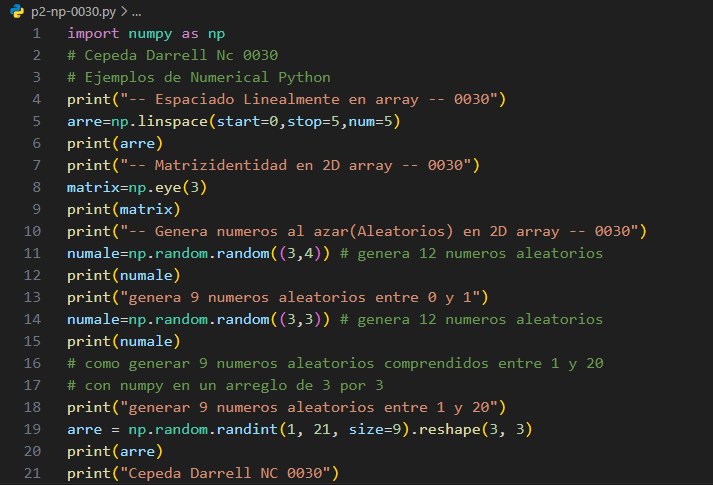
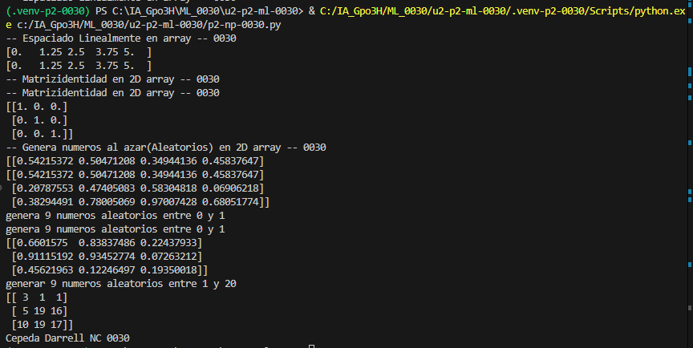

- start=0: Valor inicial de la secuencia.
- stop=1: Valor final de referencia (no se incluye si se generan varios valores).
- num=5: Cantidad de valores que se van a generar.

## que es linspace
`linspace()` es una función de NumPy que genera una cantidad específica de números distribuidos uniformemente entre un valor inicial y uno final.

## El codigo

## resultado

